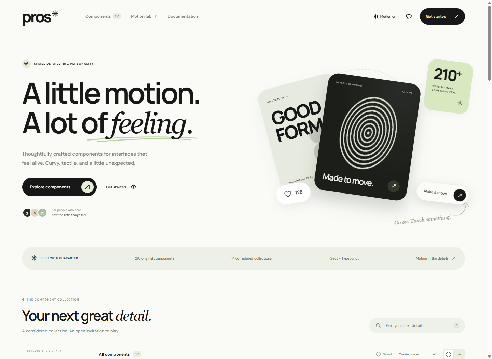
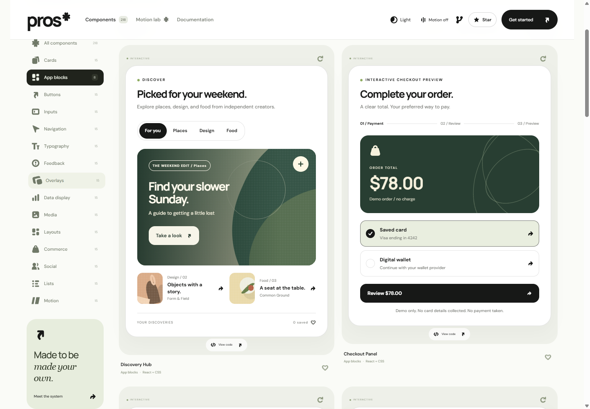

# Pros

An original React component library by **draexon**. 218 components across 15 collections, built around rounded forms, a monochrome palette, and purposeful motion.

**Live gallery: [pros.draexon.dev](https://pros.draexon.dev)**



## Install

Install straight from GitHub. The package builds itself during install, so there is nothing to compile by hand:

```sh
npm install github:draexon/pros
```

npm 12 and later block git dependencies by default. If you see `EALLOWGIT`, run `npm install github:draexon/pros --allow-git=root` instead, or add `allow-git=root` to your project's `.npmrc`.

Then import the stylesheet once and use any component:

```tsx
import { ProsProvider, EditorialCard, RangeInput } from "@draexon/pros";
import "@draexon/pros/style.css";

export function Example() {
  return (
    <ProsProvider>
      <EditorialCard
        title="Your own point of view."
        onAction={(action) => console.log(action)}
      />
      <RangeInput label="Intensity" defaultValue="64" />
    </ProsProvider>
  );
}
```

The package provides ES modules, CommonJS, TypeScript declarations, and a separate stylesheet. React 18.3 or 19 and React DOM are peer dependencies. No existing UI or motion component library is used.

A release on the npm registry (`npm i @draexon/pros`) is planned. Until then, the GitHub install above is the supported route.

## Run the gallery

```sh
npm install
npm run dev
```

Open the local URL printed by Vite. The gallery includes live interactive previews, full source modules, usage examples, search, saved components, adjustable preview surfaces, and a persistent motion switch. Press `/` to smoothly focus search, then Escape to clear it or leave the field. The custom sort menu supports Curated order, A–Z, and Z–A with animated options and keyboard navigation.

## Original icons

Pros includes its own bold SVG icon family, with curved directional arrows and solid, rounded silhouettes. Icons inherit the text color and need no icon font or external package.

```tsx
import { ProsIcon } from "@draexon/pros";

<button type="button">
  Explore <ProsIcon name="arrow" size={20} />
</button>
<ProsIcon name="motion" size={24} label="Motion enabled" />
```

Icons are decorative by default. Use `label` for a standalone meaningful icon; give icon-only buttons an accessible label. The component source viewer includes `icons.tsx` alongside the shared core and stylesheet.

## The collections

The 14 original collections each contain 15 individually exported components. App blocks adds eight larger consumer app surfaces:

| Collection   | Examples                                                  |
| ------------ | --------------------------------------------------------- |
| App blocks   | DiscoveryHub, TrendingBoard, ShoppingBag, CheckoutPanel   |
| Cards        | EditorialCard, StackedCard, TicketCard, FoldCard          |
| Buttons      | ArrowButton, HoldButton, RollingButton, OrbitButton       |
| Inputs       | OtpInput, TagInput, FileDropzone, RatingInput             |
| Navigation   | PillTabs, IconDock, ChapterRail, AlphabetIndex            |
| Typography   | WordReveal, CircularText, RotatingWord, InkHeadline       |
| Feedback     | RingProgress, MilestoneNotice, DotLoader, EmptyCollection |
| Overlays     | CommandPalette, SideDrawer, ImageLightbox, SpotlightTour  |
| Data display | BarChart, Heatmap, SortableTable, WaterfallChart          |
| Media        | Filmstrip, ImageCompare, Polaroid, CoverArt               |
| Layouts      | BentoGrid, ResizablePanel, MasonryBoard, HeroBlock        |
| Commerce     | ProductCard, BundleBuilder, OrderSummary, ShippingTracker |
| Social       | PollCard, ChatPanel, InviteForm, CommentThread            |
| Lists        | ReorderList, KanbanBoard, ReadingList, SearchableList     |
| Motion       | TiltSurface, MagneticField, DragTrack, RevealCurtain      |

The complete inventory is in [COMPONENTS.md](COMPONENTS.md).

## Content and state

Components share the exported `ProsProps` and `ProsItem` types. Exact supported props and event names are documented by the implementation shown in each component's source tab.

- `title`, `description`, `label`, `items`, and `children` customize supported content.
- `className` and `style` style the outer surface.
- Controls using `useModel` accept `value`, `defaultValue`, and `onValueChange`. A supplied `value` makes them controlled.
- Toggle values are `"true"` or `"false"`; numeric values are number strings. Multi-selection uses comma-separated labels, so item labels must be unique and must not contain commas.
- Some compound examples, such as chat, checklist, kanban, and tour state, are local compositions. Use their callbacks to connect your own data layer or adapt their source for full control.
- `onAction` delivers actions to your application. Checkout, file download, sharing, invite, email, and contact actions require your app's service integration. No backend or payment service is bundled.
- `image` supplies images. `VideoFrame` and `AudioPlayer` use `href` for actual media sources and native playback controls. `AudioCard` is a playback-control surface with play/pause callbacks.
- Default chart values, names, dates, amounts, and statistics are illustrative data.

## Larger consumer app blocks



Eight reusable app surfaces are available in **App blocks**, with wider live previews and individual source and usage pages. Their motion includes sliding selections, staggered content, animated totals, expanding panels, reversible collection edits, and checkout confirmation. Provider motion settings and system reduced motion apply to all eight.

| Component                                       | Data and integration props                                                                              |
| ----------------------------------------------- | ------------------------------------------------------------------------------------------------------- |
| DiscoveryHub / TrendingBoard / CollectionStudio | `stories: ConsumerStory[]`; unique IDs, title, category, creator, detail, optional image and popularity |
| ShoppingBag                                     | `products: ConsumerProduct[]`, `currency`, `shipping`, `freeShippingAt`, `onCheckout(lines: BagLine[])` |
| CheckoutPanel                                   | `amount`, `currency`, `methods`, async `onConfirm(request: CheckoutRequest)`                            |
| MembershipStudio                                | `plans: MembershipPlan[]`, `currency`, `onSelectPlan(id, billing)`                                      |
| OrderJourney                                    | `milestones: OrderMilestone[]`, zero-based `currentStep`, `arrival`, `orderNumber`                      |
| RewardsWallet                                   | `points`, `rewards: ConsumerReward[]`, `onSelectReward(reward)`                                         |

All these types are exported. Pass an empty array to show an empty state. Pass `disabled` to disable every control in the block. Discovery, trending, checkout, and memberships accept controlled `value` / `onValueChange` for their primary selection. Saved items, cart quantities, and other demo state are local; connect action events to your store or adapt the source for persistence. Images can replace the built-in CSS artwork through each story or product's `image` field.

Monetary inputs are nonnegative integer **minor units**: 4800 is $48.00 for USD, while 4800 is ¥4,800 for JPY. Membership `yearly` is the entire annual price, not a monthly equivalent. Cart totals exclude taxes and calculate shipping against the subtotal.

`CheckoutPanel` performs no payment by default. Its preview is clearly labeled and never collects card details. For an integrated checkout, supply your provider's actual method IDs and `onConfirm`; the component waits for the returned promise, prevents repeated submissions while pending, and shows retry on rejection. Resolve only after confirmation by your integration. Validate the amount, order, and method on your server and use the payment provider's idempotency mechanism. No payment credentials belong in component props.

`onAction` events include `open:<id>`, `save:<id>`, `unsave:<id>`, `remove:<id>`, `restore:<id>`, `quantity:<id>:<count>`, `checkout`, `preview-complete`, `confirmed`, `subscribe:<plan>:monthly|yearly`, `milestone:<index>`, `support:<order>`, and `redeem:<reward>`. Membership and reward callbacks represent a selection, not a completed subscription or redemption. Viewing a future delivery milestone does not change the actual order status.

## Motion and accessibility

Every component has an entrance; interactive elements add purpose-specific transitions. Shared press and release feedback works for mouse, touch, keyboard, and reversed toggle actions. Action menus support arrows, Home, End, Escape, outside dismissal, and focus return, and stay within the viewport. Saved gallery items have an Undo action. The library uses native CSS animation, pointer events, and native dialog behavior. Dialogs support Escape, focus containment, and focus return. Tabs support arrow keys, Home, and End. Keyboard focus remains visible.

```tsx
<ProsProvider motion={false}>
  <YourApp />
</ProsProvider>
```

The provider switch and `prefers-reduced-motion` disable decorative animation while preserving state changes. The gallery adds pointer-responsive hero layers, magnetic actions, scroll-triggered reveals, and animated arrow transitions. Continuous animation can be paused from the gallery header. Native media playback remains user-controlled.

Core tokens:

```css
:root {
  --pros-ink: #171817;
  --pros-paper: #ffffff;
  --pros-radius: 28px;
  --pros-duration: 450ms;
  --pros-ease: cubic-bezier(0.22, 1, 0.36, 1);
  --pros-spring: cubic-bezier(0.34, 1.56, 0.64, 1);
}
```

Typography uses Manrope and DM Sans through Google Fonts, with system fallbacks. Self-host fonts or override the families for an offline-only application. The gallery follows your system theme on the first visit and remembers your light or dark choice. Its header switch reveals the new theme through three offset diagonal strips, reversing direction between light and dark, with an immediate change when motion is disabled. Library consumers can use `<ProsProvider theme="dark">` or `theme="light"`; omitted themes inherit the surrounding palette.

## Validate

```sh
npm run check
npm run build
npm test
npm run test:browser
```

`npm test` builds the library and checks every public component with server rendering, custom content, empty collections, safe button types, packaging compatibility, unique identifiers, controlled values, and calculations. `npm run test:browser` checks all 218 previews at desktop and mobile widths in both themes, plus dropdown keyboard behavior, undo, dialogs, theme persistence, and reduced motion against the production build. Build the gallery first. The browser suite uses installed Edge on Windows; on other systems run `npx playwright install chromium` once, or choose an installed browser with `PLAYWRIGHT_CHANNEL`. Browser validation notes are recorded in [docs/VALIDATION.md](docs/VALIDATION.md).

## Project layout

- `src/library/` - original component modules, shared primitives, and scoped styles.
- `src/catalog.json` - complete searchable component metadata.
- `src/App.tsx` - gallery, detail playground, and documentation.
- `dist/` - generated reusable package.
- `site/` - generated gallery website.
- `tests/` - package and rendering tests.
- `scripts/publish.ps1` - verifies the draexon GitHub account and repository, then pushes the current commit (`npm run publish:repo`).
- `vercel.json` - Vercel build, output, cache, and security header configuration.

## Deployment

The gallery is a static site hosted on Vercel at [pros.draexon.dev](https://pros.draexon.dev), deployed from `main` through the Git integration. The settings live in `vercel.json`:

- Install command: `npm ci`
- Build command: `npm run build` (type check, then the Vite production build)
- Output directory: `site`

The gallery uses hash routes, so no rewrites are needed and every route is served from the domain root. Hashed files in `/assets` are cached as immutable, and all responses carry `nosniff`, referrer, frame, and permissions headers. The link preview image is `public/og.png`, served at `/og.png`.

## Design research

Editorial layouts and printed matter collected on [Are.na](https://www.are.na/rachel-steele/layout-editorial-kl3d-_flrj4), [Pinterest typography references](https://it.pinterest.com/pin/business-cards-design-inspiration-black-and-white-graphic-design-typography--814799757554549066/), and physical objects informed the direction. All component implementations and geometric artwork are original. No third-party reference artwork is redistributed.

## Contributing

Read [CONTRIBUTING.md](CONTRIBUTING.md) before opening a pull request. Community participation follows our [Code of Conduct](CODE_OF_CONDUCT.md). Report vulnerabilities using [SECURITY.md](SECURITY.md).

## License

[MIT](LICENSE), copyright 2026 draexon.

## Repository star count

The navbar displays the repository's GitHub star count. The count loads live from GitHub without credentials; rate limits and offline sessions use the fallback in `src/repo-stats.json`. Run `npm run update:repo-stats` with an authenticated GitHub CLI session before building to refresh that verified fallback. No GitHub token is included in the browser bundle.
